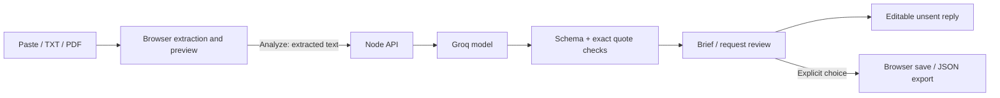

# ScopeLedger

**Good work. Clear terms.** A workspace for freelancers to turn an agreement into a cited project brief, check a client's new request, and prepare a reply they can edit.

The first version connects three practical steps: **agreement → scope check → conversation**. Every supported finding links back to exact source text. Missing project context remains a question. There is no legal risk score, accuracy percentage, or automatic approval.

## Try it locally

Use Node 24 or newer. Node 22.13+ is also supported by the dependencies.

```sh
npm ci
cp .env.example .env
npm run dev
```

On PowerShell, use `Copy-Item .env.example .env` for the middle command. Open **http://localhost:5187**. Without `.env`, the default port is also 5187.

The complete fictional Willow Studio example works without an API key: compare a mixed request, included work, and a request with missing context; inspect citations; edit and download a reply.

For your own agreement, add a Groq key to the local `.env` file, then restart the server. Keep it server-side; never paste keys into client code or commit `.env`. The default model is configurable with `GROQ_MODEL`. A configured key is not proof of valid credentials or model availability; provider failures are shown as errors.

## What works

- Pasted English text, UTF-8 TXT, or text-based PDF, extracted on your device.
- Six brief categories: deliverables, exclusions, revisions, payment, timeline, ownership.
- Item-by-item request review: appears included, potential addition, or needs clarification.
- Exact quoted evidence, actual PDF page numbers, and an original-text reader.
- Editable replies with your own optional fee/schedule proposals; copy, TXT, or Markdown export.
- One active project, up to 20 reviews, explicit browser save/restore, and portable JSON records.
- Browser imports rebuild source identity and verify citations. Imported interpretations remain labeled as imported.

Limits: 10 MB per file, 30 PDF pages, 60,000 extracted characters, 5,000 each for request/context. Inputs over limits are rejected, not silently truncated. Scanned or mixed PDFs with any textless page are rejected; complex PDF reading order requires checking the preview. OCR, DOCX, multiple simultaneous projects, accounts, e-signatures, and invoicing are outside this version.

## Data flow



The original PDF or TXT binary stays in the browser. Analyze sends the extracted agreement text to this server and Groq. Reviewing a request sends the agreement, request, and supplied context again. The server does not store documents and application code does not log their content. Hosting infrastructure and provider handling are separate policies; review them before using sensitive documents. Fonts load from Google Fonts, with local fallback fonts if unavailable.

No automatic local saving occurs. Saving includes the full agreement, findings, notes, and drafts in unencrypted browser storage. Exported JSON also contains that information. Delete saved copy removes the saved record, while the current in-memory workspace remains until replaced or reloaded. A browser reload starts with the example; use Restore to open a saved record.

## Engineering choices

- **React + TypeScript + Vite** for the responsive client; **Express** for a same-origin API.
- **Zod** validates inputs and model output; the server rebuilds trusted source blocks rather than accepting client-supplied offsets.
- **SHA-256** ties analyses to a canonical source version. Delayed responses cannot enter a replaced project's history.
- Citations are `{blockId, quote}`. The verifier rejects unknown blocks, missing/ambiguous quotes, and unsupported verdicts without evidence. Offsets and pages are derived from the source.
- Document and request text enter the provider prompt as untrusted data. A matching quotation does **not** establish that an interpretation is correct; semantic grounding still needs evaluation and user review.
- Rate limits, JSON body limits, allowed origins, bounded provider responses, and timeouts guard the API. Provider failures never fall back to fabricated live results.

Source map: `shared/` contains schema, evidence, fixtures, imports and draft assembly; `server/` contains API/provider; `client/` contains file handling and workspace; `tests/` covers behavior; `eval/` contains synthetic model checks.

## Verify

```sh
npm test
npm run build
npm run eval
```

Tests and build require no AI key. `eval` makes six real provider calls when a key is configured. It exits **2 / NOT_RUN** without a key, **1** on a failed case, and **0** when all six verdict sets and citation checks pass. Its report includes the returned explanations for manual inspection. This is a small smoke suite, not a representative legal benchmark. See [validation notes](docs/validation.md) for what was actually run.

## Run the production build

```sh
npm run build
npm start
```

The Node server serves `dist/` and `/api` together. This is not a static-only Vercel upload; deploy it as a Node service, or add an appropriate serverless adapter. Set `HOST=0.0.0.0` only in a hosting environment that needs it, set `APP_ORIGIN` to your exact HTTPS origin, and provide `PORT` and server-side Groq credentials through that host's secret store.

Before opening a public, provider-funded endpoint, add the host's access/spend controls and configure a shared rate-limit store for multiple instances. The current in-memory limiter is suited to a single instance; proxy IP trust is intentionally not guessed. No public deployment is included in this repository's initial handoff.

## Origin and attribution

This is a fresh implementation and independent Git history inspired by lessons from [Sukhmeet31/LegalEase](https://github.com/Sukhmeet31/LegalEase), forked from [hemanth090/LegalEase](https://github.com/hemanth090/LegalEase). The original LegalEase project credits Kokkonda Naveen Hemanth under MIT. ScopeLedger does not copy its application code; this acknowledgment preserves the idea's history while the new product focuses on freelance scope changes.

ScopeLedger is a working aid, not legal advice, an enforceability assessment, or a guarantee of payment. Review the supplied agreement and draft before relying on or sharing any result.
