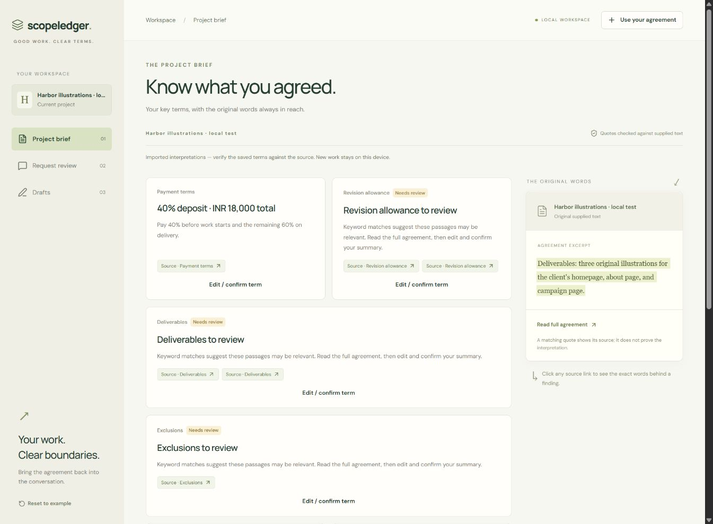
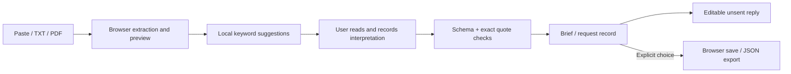

# ScopeLedger

**Good work. Clear terms.** A workspace for freelancers to turn an agreement into a cited project brief, check a client's new request, and prepare a reply they can edit.

The first version connects three practical steps: **agreement → scope check → conversation**. Your own agreements work without an API key or AI account. Local word matching suggests passages; you read the source, confirm terms, and record scope decisions. There is no legal risk score, accuracy percentage, or automatic approval.



## Try it locally

Use Node 24 or newer. Node 22.13+ is also supported by the dependencies.

```sh
npm ci
npm run dev
```

Open **http://localhost:5187**. No `.env` or API key is needed. The default port is 5187.

The complete fictional Willow Studio example works without an API key: compare a mixed request, included work, and a request with missing context; inspect citations; edit and download a reply.

Choose **Use your agreement → Open local workspace**. Review the suggested clauses, use **Edit / confirm term** to write your summary, then **Request review → Find related clauses → Record decision**. Finish with **Prepare a reply**. Save or export explicitly to keep your work.

### Start without spending money

Run the app on your own computer. The default workspace needs no paid hosting, database, domain, subscription, API key, or local model installation. Agreement text, clause suggestions, decisions, and reply templates are processed in the browser. Ordinary computer and internet access are the only prerequisites for installing/loading the app.

This mode does not interpret legal meaning automatically. English keyword matching can miss wording, exceptions, negations, and implications. No match does not mean no term exists. Read the full agreement and add source quotes yourself where necessary. A request starts as **Needs clarification**, even when matching words are found. Separate mixed requests when different parts need different decisions.

## What works

- Pasted English text, UTF-8 TXT, or text-based PDF, extracted on your device.
- Six brief categories with editable, source-linked summaries: deliverables, exclusions, revisions, payment, timeline, ownership.
- Local request records with related passages and your manual decision: appears included, potential addition, or needs clarification.
- Exact quoted evidence, actual PDF page numbers, and an original-text reader.
- Editable replies with your own optional fee/schedule proposals; copy, TXT, or Markdown export.
- Changing a recorded decision preserves your edited reply and flags it to check before sharing.
- Local reply templates retain the full request and your recorded reasoning, with room for 32,000 characters. Project context and private notes are not automatically copied into replies.
- One active project, up to 20 reviews, explicit browser save/restore, and portable JSON records.
- Browser imports rebuild source identity and verify citations. Imported interpretations remain labeled as imported.

Limits: 10 MB per file, 30 PDF pages, 60,000 extracted characters, 5,000 each for request/context. Inputs over limits are rejected, not silently truncated. Scanned or mixed PDFs with any textless page are rejected; complex PDF reading order requires checking the preview. OCR, DOCX, multiple simultaneous projects, accounts, e-signatures, and invoicing are outside this version.

## Data flow



The default UI makes no analysis or provider-status API requests. Neither the original file nor its extracted text is uploaded. Fonts load from Google Fonts, with local fallback fonts if unavailable; this does not send agreement content. The app is not an installable offline PWA, so it still needs its local server or static host to load.

No automatic local saving occurs. Saving includes the full agreement, findings, notes, and drafts in unencrypted browser storage. Exported JSON also contains that information. Delete saved copy removes the saved record, while the current in-memory workspace remains until replaced or reloaded. A browser reload starts with the example; use Restore to open a saved record.

## Engineering choices

- **React + TypeScript + Vite** for the responsive client; **Express** for a same-origin API.
- **Zod** validates inputs, manual annotations, imported records, and optional model output.
- **SHA-256** ties analyses to a canonical source version. Delayed responses cannot enter a replaced project's history.
- Citations are `{blockId, quote}`. The verifier rejects unknown blocks, missing/ambiguous quotes, and unsupported verdicts without evidence. Offsets and pages are derived from the source.
- Local matching only retrieves possible passages. A matching quotation does **not** establish that an interpretation is correct; the user records the decision.
- Rate limits, JSON body limits, allowed origins, bounded provider responses, and timeouts guard the API. Provider failures never fall back to fabricated live results.

Source map: `shared/` contains schema, evidence, fixtures, imports and draft assembly; `server/` contains API/provider; `client/` contains file handling and workspace; `tests/` covers behavior; `eval/` contains synthetic model checks.

## Verify

```sh
npm test
npm run build
```

Tests and build require no AI key. The local UI test forbids fetch while exercising intake, manual annotations, request records, and draft preservation. See [validation notes](docs/validation.md) for what was actually run.

### Optional provider development

The original Groq API and `npm run eval` remain available for future development, but the current UI does not call them, even if a key is configured. To test them deliberately, copy `.env.example` to `.env`, add your own server-side `GROQ_API_KEY`, and select an available model using `GROQ_MODEL`. Never commit secrets. Account pricing and quotas are separate from the no-key workspace: check [Groq rate limits](https://console.groq.com/docs/rate-limits) and [billing details](https://console.groq.com/docs/billing-faqs) before enabling calls.

`eval` makes six real provider calls when a key is configured. It exits **2 / NOT_RUN** without a key, **1** on a failed case, and **0** when all six verdict sets and citation checks pass. This is a small smoke suite, not a representative legal benchmark. Live model evaluation has not been run.

Evaluation waits 65 seconds between cases by default to stay within a low token-per-minute quota, so allow about six minutes. Set `EVAL_INTERVAL_MS` only to match your account's limits; pacing does not bypass daily quotas or guarantee that a large individual request fits.

## Run the production build

```sh
npm run build
npm start
```

The Node server serves `dist/` and the optional `/api` together. The no-key UI can also run from `dist/` on a static HTTPS host; it needs no server API. The optional provider endpoints require a Node service or an appropriate serverless adapter. Set `HOST=0.0.0.0` only when hosting requires it, and set `APP_ORIGIN` to the exact HTTPS origin if exposing the API.

Before opening a public, provider-funded endpoint, add the host's access/spend controls and configure a shared rate-limit store for multiple instances. The current in-memory limiter is suited to a single instance; proxy IP trust is intentionally not guessed. No public deployment is included in this repository's initial handoff.

## Origin and attribution

This is a fresh implementation and independent Git history inspired by lessons from [Sukhmeet31/LegalEase](https://github.com/Sukhmeet31/LegalEase), forked from [hemanth090/LegalEase](https://github.com/hemanth090/LegalEase). The original LegalEase project credits Kokkonda Naveen Hemanth under MIT. ScopeLedger does not copy its application code; this acknowledgment preserves the idea's history while the new product focuses on freelance scope changes.

ScopeLedger is a working aid, not legal advice, an enforceability assessment, or a guarantee of payment. Review the supplied agreement and draft before relying on or sharing any result.
